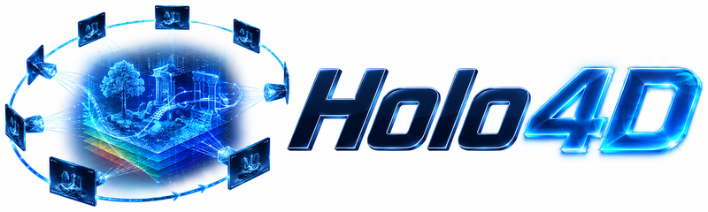
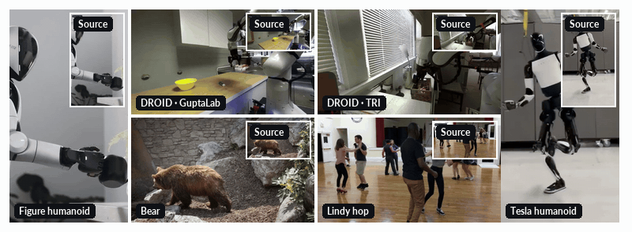

<p align="center">
  
</p>

**Holistic 4D Reconstruction as Geometric Control for Video Diffusion** (NeurIPS 2026)

[Website](https://nirvanalan.github.io/projects/holo4d/) · [Paper](https://nirvanalan.github.io/projects/holo4d/static/pdfs/holo4d-paper.pdf)



This repository will host the Holo4D code. Release coming soon.

## Citation

```bibtex
@inproceedings{lan2026holo4d,
  title     = {{Holo4D}: Holistic 4D Reconstruction as Geometric Control for Video Diffusion},
  author    = {Lan, Yushi and Jiang, Zeren and Namekata, Koichi and Pan, Xingang and Zheng, Chuanxia and Vedaldi, Andrea},
  booktitle = {Advances in Neural Information Processing Systems},
  year      = {2026}
}
```
