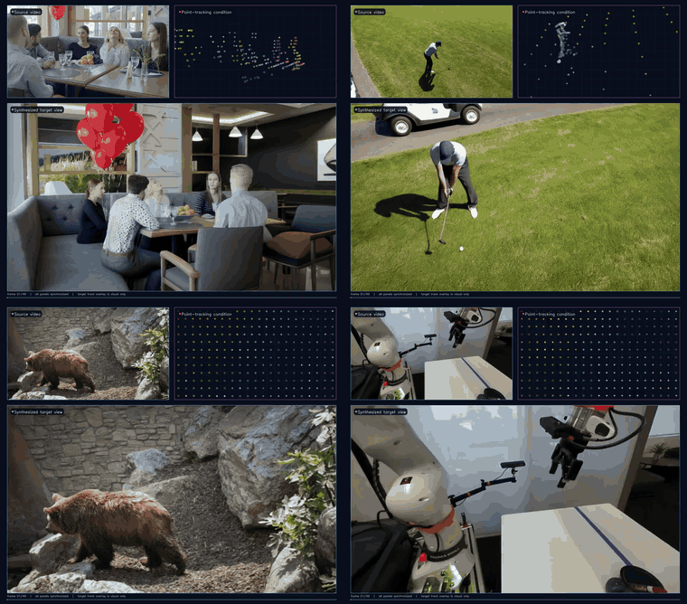
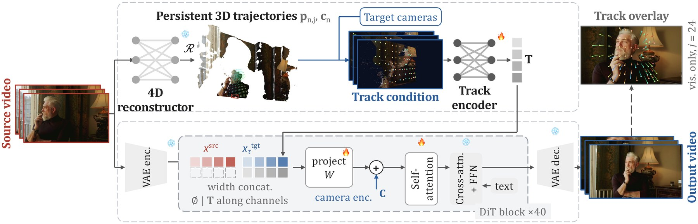
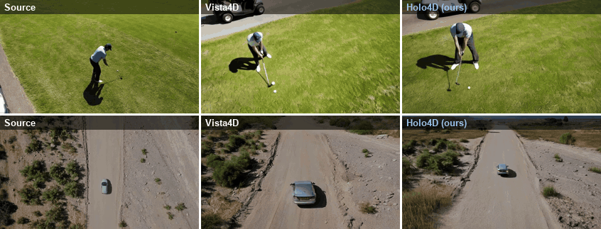
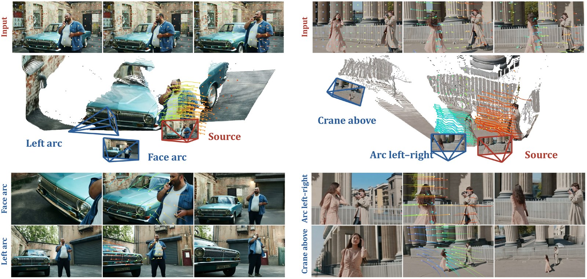
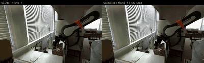
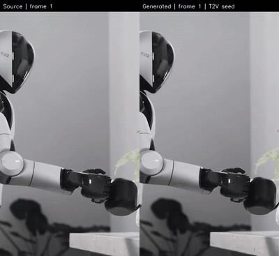

<div align="center">
    <h1>
    Holo4D: Holistic 4D Reconstruction as Geometric Control for Video Diffusion (NeurIPS 2026)
    </h1>
</div>

<p align="center">
  <a href="https://nirvanalan.github.io/projects/holo4d"></a>
  <a href="https://arxiv.org/abs/2610.25276"></a>
  <a href="https://huggingface.co/yslan/Holo4D-2026"></a>
  
</p>

<p align="center">
  <a href="https://nirvanalan.github.io/">Yushi Lan</a><sup>1*</sup>&emsp;<a href="https://jzr99.github.io/">Zeren Jiang</a><sup>1*</sup>&emsp;<a href="https://kmcode1.github.io/">Koichi Namekata</a><sup>1</sup>&emsp;<a href="https://xingangpan.github.io/">Xingang Pan</a><sup>2</sup>&emsp;<a href="https://chuanxiaz.com/">Chuanxia Zheng</a><sup>2</sup>&emsp;<a href="https://www.robots.ox.ac.uk/~vedaldi/">Andrea Vedaldi</a><sup>1</sup>
  <br>
  <sup>1</sup>University of Oxford&emsp;<sup>2</sup>Nanyang Technological University&emsp;<sup>*</sup>Equal contribution
</p>

<p align="center">
  <b>Holo4D</b> reshoots a monocular video along a new camera path, guiding a pretrained video diffusion model with <b>persistent 3D trajectories</b> reconstructed from the source video.
</p>

<div align="center">
    
    <br>
    <sub>Each panel: source video with its 3D tracks (top left), the point-tracking condition in the target view (top right) and the synthesized target view (bottom); every other loop overlays the projected tracks for visualization.</sub>
    <br>
    :open_book: See more visual results on our <a href="https://nirvanalan.github.io/projects/holo4d" target="_blank">project page</a>
</div>

<br>

<details>
<summary><b>Abstract</b></summary>
    <br>
    <div align="center">
        
        <p align="justify">
            Synthesizing a monocular video from a new camera trajectory requires preserving the observed scene geometry and motion while completing regions that become newly visible. Feed-forward 4D reconstructors recover the structure of the observed scene, whereas video diffusion models provide a generative prior for completing unseen content. We introduce Holo4D, a video reshooting framework that uses reconstructed 3D trajectories as a holistic source-view 4D scaffold. We project these trajectories into the requested views and encode their geometry and source appearance to guide a pretrained video diffusion model. Together with the source video and target cameras, the scaffold grounds generation in reconstructed observations while leaving unsupported regions to the generative prior. Experiments demonstrate the value of trajectory-based conditioning for camera control and novel-view synthesis. The framework accommodates different 4D reconstructors without retraining the video generator, allowing it to benefit from future advances in source reconstruction.
        </p>
    </div>
</details>

## :fire: News

- [2026/10] Inference code, 14B / 5B checkpoints, prepared examples, long-video rollout and evaluation tools are released.
- [2026] Holo4D is accepted to **NeurIPS 2026**.

## :movie_camera: Results

**Comparison with [Vista4D](https://github.com/eyeline-labs/vista4d)** on Vista4D's benchmark trajectories (source · Vista4D · Holo4D):

<div align="center">
    
</div>

**4D reconstruction as a scaffold.** Input video with its 3D trajectories (top), the reconstruction with source (red) and target (blue) cameras (middle), and Holo4D outputs for each path (bottom):

<div align="center">
    
</div>

More examples, including humanoid and DROID robot videos and long rollouts, are on the [project page](https://nirvanalan.github.io/projects/holo4d).

## 🔧 Installation

1. Clone Repo
    ```bash
    git clone https://github.com/NIRVANALAN/Holo4D.git
    cd Holo4D
    ```

2. Create Conda Environment
    ```bash
    conda create -n holo4d python=3.12 -y
    conda activate holo4d
    ```

3. Install Python Dependencies

    All dependencies are declared in [`pyproject.toml`](pyproject.toml). Install a CUDA-matched PyTorch stack first ([`requirements/cu130.txt`](requirements/cu130.txt) is the tested CUDA 13.0 one: PyTorch 2.9, FlashAttention 2, xFormers, torch-cluster), then the package:
    ```bash
    pip install -r requirements/cu130.txt
    pip install -e .            # add ".[eval]" for the metric dependencies, ".[dev]" for tests
    ```

Launchers use FlashAttention 2 by default (`HOLO4D_FLASH_ATTN3=1` only with compatible FA3 kernels). We sample on one H200; the unquantized 14B model with dense conditions can exceed 80 GB.

## :computer: Inference

### Quick start: prepared examples

The prepared pack contains five DAVIS videos and five robot videos with captions, dense 4D geometry and target cameras, so **no 4D reconstructor needs to be installed**. Checkpoints, the Wan base model and the examples are downloaded from [🤗 Hugging Face](https://huggingface.co/yslan/Holo4D-2026) on first run.

```bash
EXAMPLE=davis_bear bash inference/demo_examples.sh                       # Holo4D-14B
MODEL=5b-commercial EXAMPLE=davis_bear bash inference/demo_examples.sh   # Holo4D-5B, 384x672
MODEL=5b-full       EXAMPLE=davis_bear bash inference/demo_examples.sh   # Holo4D-5B, 704x1280
EXAMPLE=robot_figure1 bash inference/demo_examples.sh                    # portrait robot video
```

Outputs go to `outputs/examples/<model>/<example>/` (49 frames, 50 steps, CFG 5, shift 5, seed 42, 16 FPS).
Examples: `davis_bear`, `davis_blackswan`, `davis_bike-packing`, `davis_car-turn`, `davis_bus`, `robot_figure0`, `robot_figure1`, `robot_tesla`, `robot_gupta`, `robot_tri`.
Set `HOLO4D_CACHE_DIR` to relocate downloads; append `--validate-only` to check the inputs without sampling.

### Models

| Model | Backbone | Resolution | Track condition | File on 🤗 `yslan/Holo4D-2026` |
|---|---|---|---|---|
| Holo4D-14B | Wan2.1-T2V-14B | 384×672 | Dense XYZ, depth, source RGB | `checkpoints/t2v_49_chunk.safetensors` |
| Holo4D-14B continuation | Wan2.1-I2V-14B-480P | 384×672 | Dense tracks + previous generated frame | `checkpoints/i2v_49_rollout.safetensors` |
| Holo4D-5B (commercial mixture) | Wan2.2-TI2V-5B | 384×672 | Dense, no identity embedding | `checkpoints_5b/commercial_dense_noid_384x672_step29000.safetensors` |
| Holo4D-5B (full mixture) | Wan2.2-TI2V-5B | 704×1280 | Dense, identity target | `checkpoints_5b/v2v_id_target_704x1280_step27000.safetensors` |

Keep the backbone, track condition and resolution of each row together.

### Your own videos

Holo4D needs per-frame cameras and dense persistent 3D tracks of the source video, from either [**4RC**](https://github.com/Luo-Yihang/4RC) or **VGGT-Ω + CoWTracker** (optionally with GMOS static/dynamic fusion). Install the reconstructor separately, then build the condition and sample in one command:

```bash
CHECKPOINT=/path/to/t2v_49_chunk.safetensors WAN_ROOT=/path/to/Wan2.1-T2V-14B \
python inference/preprocess_raw_video.py \
  --video my_video.mp4 --caption "A person walks along a street." \
  --output-dir outputs/raw/my_video --backend 4rc \
  --fourrc-repo /path/to/4RC --fourrc-env 4rc --holo-env holo4d \
  --trajectory orbit_right --angle-deg 30 --sample
```

The command uses the first 49 frames at 16 FPS (one window). Portrait videos need `--width 384 --height 672`. See the [inference guide](inference/README.md) for the CoWTracker + VGGT-Ω backend, GMOS, trajectories and the condition format.

<details>
<summary><b>Vista4D benchmark trajectories</b></summary>

```bash
VIDEO_NAMES=avocado-slice bash inference/sample_vista4d.sh
```

The default uses the native target cameras at full amplitude, with per-frame intrinsics. Use the complete [Vista4D evaluation data](https://huggingface.co/datasets/Eyeline-Labs/Vista4D-Eval-Data) with `VISTA4D_EVAL_ROOT`, `FRAME_ROOT` and `MAX_CAMERAS_PER_VIDEO=0` for all 110 trajectories. The older shared-first-frame, half-amplitude protocol (`TRAJECTORY_MODE=shared-first-frame-half`) is kept for reference only; do not mix results of the two protocols.
</details>

<details>
<summary><b>Syn4D</b></summary>

```bash
SYN4D_ROOT=/data/Syn4D SYN4D_CAPTION_DIR=/data/captions \
SEQUENCE_IDXS=0 CAMERA_PAIRS=0-1 bash inference/sample_19500_syn4d.sh

SYN4D_ROOT=/data/Syn4D SCENES=flying_group \
SEQUENCE_IDXS=0 CAMERA_PAIRS=0-1 bash inference/sample_5b_commercial_syn4d.sh
```
</details>

### Long videos

Videos longer than 49 frames are generated window by window: Holo4D-14B generates the first window, and the continuation model generates each next window conditioned on the last generated frame (windows overlap by one frame). Two prepared robot videos replay without any reconstructor:

```bash
EXAMPLE=tri_static_high bash inference/demo_robot_rollouts.sh   # DROID, 246 frames
EXAMPLE=figure0_orbit   bash inference/demo_robot_rollouts.sh   # Figure humanoid, 81 frames
```

| DROID manipulation | Figure humanoid |
|:---:|:---:|
| [](assets/demo/robot_long/tri_static_high.mp4) | [](assets/demo/robot_long/figure0_orbit.mp4) |

Animated GIF previews play directly on GitHub; click either preview for its full MP4.
Rebuild the previews with `python scripts/build_rollout_readme_gifs.py` (FFmpeg required).

The continuation model is trained with OmniWorld-DROID, so robot windows after the first are not zero-shot. Details: [doc/release/2026-10-11-prepared-robot-long-rollouts.md](doc/release/2026-10-11-prepared-robot-long-rollouts.md).

## :zap: Visualization

A local gallery shows source and novel-view videos side by side for all prepared examples:

```bash
python -m http.server 8000 --bind 127.0.0.1
# open http://127.0.0.1:8000/media/docs/gallery.html
```

See [doc/visualization.md](doc/visualization.md).

## :100: Quantitative Results

*Camera control and video quality on DAVIS* (100 video–trajectory pairs; cameras recovered with VGGT-Ω; ATE ×10², RPE-T ×10³, RPE-R in degrees).

| Method | Control | ATE ↓ | RPE-T ↓ | RPE-R ↓ | Aesthetic ↑ | Imaging ↑ | Subject ↑ | Background ↑ | Temporal ↑ |
|---|---|---:|---:|---:|---:|---:|---:|---:|---:|
| ReCamMaster | Extrinsics | 9.547 | 15.37 | **0.099** | 0.493 | 0.503 | **0.922** | **0.942** | **0.256** |
| TrajectoryCrafter | Point cloud | 3.533 | 4.817 | 0.207 | **0.500** | 0.548 | 0.894 | 0.923 | 0.253 |
| EX-4D | Point cloud | 2.903 | 3.560 | 0.587 | 0.442 | 0.377 | 0.827 | 0.899 | 0.238 |
| Gen3C | Point cloud | 5.168 | 7.581 | 0.386 | 0.454 | 0.450 | 0.856 | 0.911 | 0.248 |
| Vista4D | Point cloud | 3.576 | 3.608 | 0.132 | 0.478 | 0.534 | 0.904 | 0.926 | 0.256 |
| **Holo4D-14B** | 3D tracks | **1.657** | **2.415** | 0.102 | 0.493 | **0.601** | 0.910 | 0.931 | 0.253 |

*Novel-view synthesis on iPhone/DyCheck* (five scenes; "m": masked to co-visible pixels; α: 4RC, β: VGGT-Ω + CoWTracker, same generator).

| Method | mPSNR ↑ | mSSIM ↑ | mLPIPS ↓ | PSNR ↑ | SSIM ↑ | LPIPS ↓ |
|---|---:|---:|---:|---:|---:|---:|
| ReCamMaster | 10.34 | 0.478 | 0.628 | 10.56 | 0.326 | 0.689 |
| TrajectoryCrafter | 11.56 | 0.438 | 0.569 | 11.14 | 0.288 | 0.631 |
| EX-4D | 13.31 | **0.520** | 0.464 | 12.91 | **0.366** | 0.532 |
| Gen3C | 12.42 | 0.469 | 0.489 | 12.20 | 0.312 | 0.550 |
| Vista4D | 12.84 | 0.487 | 0.484 | 12.46 | 0.328 | 0.535 |
| Holo4D-14B<sup>α</sup> | 13.22 | 0.484 | 0.435 | 12.68 | 0.326 | 0.509 |
| **Holo4D-14B<sup>β</sup>** | **14.03** | 0.507 | **0.379** | **13.20** | 0.348 | **0.465** |

Read our [paper](https://arxiv.org/abs/2610.25276) for Vista4D's 110 trajectories, Syn4D, reconstructor swaps and robot policy learning.

## ⏳ Runtime and Memory

Track features enter each DiT block along channels, so self-attention sees no extra tokens. Matched comparison with Vista4D on one H200 (384×672×49, 50 denoising steps; N = 13,104 latent tokens per video):

| | Vista4D | Holo4D-14B |
|---|---:|---:|
| Tokens per DiT layer ↓ | 3N | **2N** |
| Step time (s) ↓ | 9.89 | **7.39** (1.34× faster) |
| Total time per video (s) ↓ | 581.9 | **570.9** |
| Peak memory (GiB) ↓ | 49.86 | **49.14** |

Source reconstruction is paid once per video and reused across target trajectories (8.8 s for 4RC, 11.8 s for VGGT-Ω + CoWTracker on an A6000).

## 📈 Evaluation

| Task | Entry point |
|---|---|
| Camera control: ATE / RPE with VGGT-Ω | [eval/common/eval_camera_metrics_vggt_omega.sh](eval/common/eval_camera_metrics_vggt_omega.sh) |
| Camera control: source-aligned TransErr² / RotErr with Pi3 | [eval/common/eval_camera_pi3.sh](eval/common/eval_camera_pi3.sh) |
| Video quality: five VBench dimensions | [eval/common/eval_vbench.sh](eval/common/eval_vbench.sh) |
| Syn4D paired FVD | [eval/common/eval_paired_fvd.sh](eval/common/eval_paired_fvd.sh) |
| iPhone full / masked RGB and depth | [eval/iphone/README.md](eval/iphone/README.md) |

```bash
METHOD=holo4d METHOD_PRED_ROOT=/path/to/predictions \
PAIRS_CSV=/path/to/pairs.csv CAMERAS_ROOT=/path/to/cameras \
VGGT_OMEGA_REPO=/path/to/vggt-omega VGGT_OMEGA_CHECKPOINT=/path/to/vggt_omega.pt \
EVAL_ROOT=outputs/eval bash eval/common/eval_camera_metrics_vggt_omega.sh
```

Use the same predictions, evaluator revision, resolution and aggregation for every compared method; see [eval/README.md](eval/README.md) for each protocol.

VBench0.1.5 uses a **separate NumPy1 environment**, not the inference environment.
Its dependencies are declared in the `vbench` group in `pyproject.toml`; follow
the [VBench environment instructions](eval/README.md#final-paper-protocols).

### Reproduce the paper metrics

All predictions behind the paper tables — Holo4D and every baseline — are released with their inputs and scoring data as five benchmark downloads on [🤗 Hugging Face](https://huggingface.co/yslan/Holo4D-2026/tree/d01da5570d116b7e8994bc4916b0d45a58a75b42/evaluation/benchmarks_20261019_v1) (3,235 prediction videos, 86 GB in total):

| Download | Size | Paper results |
|---|---:|---|
| `davis.zip` | 39.3 GB | DAVIS camera control and VBench (Table 2) |
| `vista4d110.zip` | 34.7 GB | Vista4D's 110 trajectories (Table 6) |
| `syn4d32.zip` | 7.2 GB | Syn4D novel-view synthesis (Table 3) |
| `iphone.zip` | 1.7 GB | iPhone/DyCheck novel-view synthesis (Table 1) |
| `robot.zip` | 2.7 GB | Robot reshooting and long-video rollouts |

Each archive contains `results/` (original prediction MP4s of every method, unchanged), `conditions/` (the source RGB, tracks, depth, cameras and captions used to sample Holo4D), `metrics/` (original per-sample scores and cached camera poses) and, for Syn4D and iPhone, `evaluation/` (target-view RGB, cameras and masks used for scoring).

1. Download and check one benchmark:
    ```bash
    hf download yslan/Holo4D-2026 \
      evaluation/benchmarks_20261019_v1/davis.zip evaluation/benchmarks_20261019_v1/SHA256SUMS \
      --revision d01da5570d116b7e8994bc4916b0d45a58a75b42 \
      --local-dir eval-results
    (cd eval-results/evaluation/benchmarks_20261019_v1 && grep davis.zip SHA256SUMS | sha256sum -c && unzip -q davis.zip)
    ```

2. Re-score camera control from the cached poses (no reconstruction model needed), from the repository root:
    ```bash
    J=eval-results/evaluation/benchmarks_20261019_v1/davis/metrics/camera_replay/davis_vista4d_4rc_0
    python eval/common/vggt_omega_camera_eval.py --phase metrics \
      --checkpoint unused --method_pred_root unused \
      --pairs_csv "$J/pairs.csv" --cameras_root "$J/cameras" --vggt_cache_root "$J/poses" \
      --target_w 672 --target_h 384 --num_frames 49 --image_resolution 512 --image_mode balanced \
      --output_json recomputed.json
    ```
    Other benchmarks use the canvas and estimator settings recorded in each run's `provenance.json`. Translation metrics on DAVIS use the 54 translation-bearing trajectories and rotation uses all 100.

3. Re-score the released videos with the scorers in [Evaluation](#-evaluation) — VGGT-Ω or Pi3 camera recovery, VBench, Syn4D paired FVD and iPhone RGB/depth — pointing `METHOD_PRED_ROOT` at `results/<collection>/`.

4. Re-generate Holo4D's videos from the released conditions with `inference/sample_examples.py` (single window) or `inference/sample_robot_rollouts.py` (long videos), using the checkpoint, steps, CFG, shift and seed recorded in each manifest.

Collections from different checkpoints, backends or protocols keep separate names (for example, the 4RC and VGGT-Ω + CoWTracker arms) and should not be pooled. Paper videos were sampled on H200; a fixed seed reproduces videos on the same GPU type but not bit-for-bit across GPU architectures. Details: [benchmark downloads](doc/release/2026-10-19-benchmark-downloads.md).

## :hotsprings: Training

Dataset layouts and licenses are in [doc/data.md](doc/data.md). Set the dataset roots and pretrained Wan weights, then run:

```bash
bash train/train_384p.sh       # Holo4D-14B, config/holo4d/train_384p.yaml
bash train/train_i2v_384p.sh   # continuation model, config/holo4d/train_i2v_384p.yaml
```

## 📁 Code Structure

```text
holo4d/            # geometry, data contracts, condition cache and continuation utilities
holo4d_runtime/    # Wan diffusion runtime
inference/         # public model entry points and launchers
examples/          # dataset-specific Python drivers
config/            # conditioning and training recipes
eval/              # camera and video metrics
train/             # training launchers
doc/               # release, data and visualization notes
assets/, media/    # small smoke inputs, demo videos and README media
```

Configuration index: [config/holo4d/README.md](config/holo4d/README.md); documentation index: [doc/README.md](doc/README.md).

## :calendar: TODO

- [x] Release inference code and 14B / 5B checkpoints.
- [x] Release prepared examples and long-video rollout.
- [x] Release evaluation code.
- [x] Release training recipes.
- [x] Release benchmark predictions, conditions and metric reproduction.
- [x] One-command raw-video preprocessing with 4RC (external installation required; [guide and backend verification status](inference/README.md)).

## :page_with_curl: License

The code is released under the [Apache-2.0 License](LICENSE). Model weights, third-party code and example videos (DAVIS, DROID, Figure, Tesla) keep their original licenses.

## :pencil: Citation

If you find our code or paper helps, please consider citing:

```bibtex
@article{lan2026holo4d,
  title   = {{Holo4D}: Holistic 4D Reconstruction as Geometric Control for Video Diffusion},
  author  = {Lan, Yushi and Jiang, Zeren and Namekata, Koichi and Pan, Xingang and Zheng, Chuanxia and Vedaldi, Andrea},
  journal = {arXiv preprint arXiv:2610.25276},
  year    = {2026}
}
```

## :pencil: Acknowledgments

This research was supported by the Sony Research Award Programme 2024 and ERC CoG UNION (101001212). We thank the Isambard-AI and Dawn AIRR supercomputers for supporting this project.

Holo4D is built on several outstanding open-source projects:

[Wan2.1](https://github.com/Wan-Video/Wan2.1) &nbsp;|&nbsp; [DiffSynth-Studio](https://github.com/modelscope/DiffSynth-Studio) &nbsp;|&nbsp; [4RC](https://github.com/Luo-Yihang/4RC) &nbsp;|&nbsp; [Vista4D](https://github.com/eyeline-labs/vista4d) &nbsp;|&nbsp; [ReCamMaster](https://github.com/KwaiVGI/ReCamMaster)

## :mailbox: Contact

If you have any question, please feel free to contact us via `lanyushi15@gmail.com` or GitHub issues.
